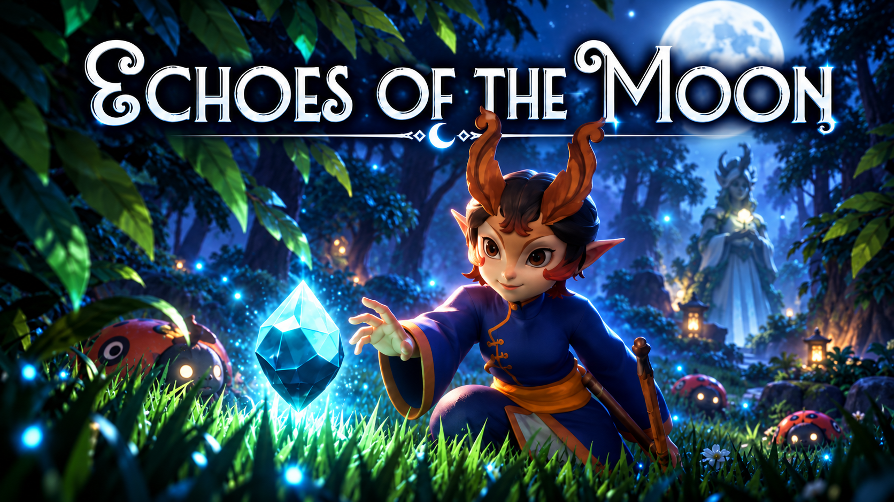

<div align="center">

# 🌙 Echoes of the Moon

### A Fantasy Adventure Game Built with Unreal Engine 5

**Explore the forest. Uncover the mystery. Restore the moonlight.**


</div>

---



---

## 🎮 About the Game

**Echoes of the Moon** is a single-player fantasy adventure game developed in **Unreal Engine 5.4** as a two-semester university project.

The game combines exploration, combat, interactive puzzles, quests, and storytelling in a mysterious forest where an ancient power has disappeared.

Players take on the role of a traveler who must uncover the secrets of a forgotten goddess, recover the fragments of a shattered Moonstone, and save the surrounding lands.

---

## 🎬 Gameplay Trailer

<div align="center">


**[▶ Watch the Gameplay Trailer on YouTube](https://www.youtube.com/watch?v=IOd48w8HyTY)**

</div>

---

## 📖 Story

*Deep within a mysterious forest, a lone traveler discovers a strange, glowing crystal.*

*Upon touching it, the traveler is suddenly transported to a nearly abandoned village.*

There, a lonely shopkeeper reveals the legend of **Lunaiset, the Moon Goddess**.

Long ago, Lunaiset possessed the **Moonstone**, a powerful source of light, prosperity, and fertility for the surrounding lands.

But one day, something terrible happened to the goddess. The Moonstone shattered into fragments, scattering across the forest.

Without its power, the lands began to wither, and the once-thriving village slowly fell into ruin.

The fragments are now guarded by mysterious creatures known as the **Moon Guardians**, preventing anyone from recovering them.

Desperate to save her homeland, the shopkeeper asks the traveler for help.

The mission seems simple:

**Defeat the Moon Guardians. Collect the fragments. Restore the Moonstone.**

But the forest holds more secrets than anyone could imagine...

*What really happened to Lunaiset? And what awaits the traveler at the end of the journey?*

---

## ✨ Gameplay Features

### 🌲 Exploration
- Explore a fantasy forest and discover hidden locations.
- Navigate interconnected areas and environments.
- Find Moonstone fragments scattered across the world.
- Discover secrets and interact with environmental objects.

### ⚔️ Combat & Survival
- Fight hostile creatures, including the Moon Guardians.
- Manage player health and stamina.
- Avoid environmental hazards.
- Use movement and combat mechanics to overcome challenges.

### 🧩 Puzzles & Challenges
- Solve interactive puzzles to progress through the story.
- Collect important quest items.
- Complete challenges to unlock new areas.
- Discover the secrets surrounding the Moonstone.

### 💬 NPCs & Quests
- Interact with characters through a dialogue system.
- Follow the main storyline and complete side quests.
- Help the village shopkeeper collect resources.
- Track objectives and quest progress.

### 🎒 Additional Systems
- Inventory and item interactions.
- Character animations and cinematic cutscenes.
- Player health and stamina interface.
- Checkpoints, teleportation, and level transitions.
- Dynamic environmental elements.

---

## 🛠️ Technologies

| Technology | Purpose |
|---|---|
| Unreal Engine 5.4 | Game engine |
| Blueprint Visual Scripting | Gameplay logic and interactions |
| Unreal Engine UMG | User interface |
| Unreal Engine AI Tools | NPC and enemy behavior |
| Git & GitHub | Version control and collaboration |

---

## 👥 Development Team

The game was developed over two university semesters by an interdisciplinary team of four students.

**Gameplay Development — Comenius University in Bratislava (FMFI UK)**

- **Palina Charnyshova** — Gameplay Programmer
- **Vladislav Vlasov** — Gameplay Programmer

**Visual Design — Academy of Performing Arts in Bratislava (VŠMU)**

- **Lenka Halžová** — Game Artist / Designer
- **Katarína Antónia Perhačová** — Game Artist / Designer

The project combined programming, gameplay design, visual art, animation, and storytelling.

---

## 👩‍💻 My Contributions

**Role: Gameplay Programmer — Palina Charnyshova**

My responsibilities focused on implementing gameplay systems, interactive features, and story-related mechanics.

### Dialogue & Quest Systems
- Developed an NPC dialogue system.
- Implemented dialogue behavior using Unreal Engine Behavior Trees.
- Created side quests and quest progression logic.
- Worked on quest completion and player interactions.

### Puzzles & Storytelling
- Implemented interactive puzzles and progression mechanics.
- Developed cinematic cutscenes for the game.
- Integrated gameplay events with story progression.

### Player Mechanics & UI
- Implemented player stamina mechanics and running animations.
- Worked on health and stamina interface elements.
- Integrated character animations and sound effects.
- Improved gameplay interactions and interface behavior.

### Development & Integration
- Integrated gameplay features into existing levels.
- Worked with designers to incorporate visual assets.
- Tested gameplay mechanics and fixed bugs.
- Collaborated with the development team using Git and GitHub.

---

## 🚀 Running the Project

This repository contains the Unreal Engine project files.

To open the project:

1. Install **Unreal Engine 5.4**.
2. Clone the repository:

   ```bash
   git clone https://github.com/cr3cker/echoes-of-the-moon.git
   ```

3. Open the project directory.
4. Launch `Echoes.uproject` using Unreal Engine 5.4.
5. Allow the engine to load the project assets.

**Note:** This is a university development project rather than a packaged commercial release. Some assets or plugins may require additional setup depending on your Unreal Engine installation.

---

## 🎓 Academic Context

**Project Type:** University Team Project  
**Duration:** Two academic semesters  
**Engine:** Unreal Engine 5.4  
**Development Team:** 4 students  

Developed as part of university coursework at Comenius University in Bratislava in collaboration with students from the Academy of Performing Arts in Bratislava.

The project provided practical experience in game development, interactive system design, interdisciplinary teamwork, and integrating programming with visual storytelling.

---

<div align="center">

### 🌙 Echoes of the Moon

*Every fragment holds a secret.*

**Built with Unreal Engine 5**

</div>
